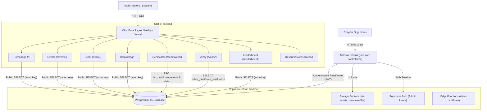
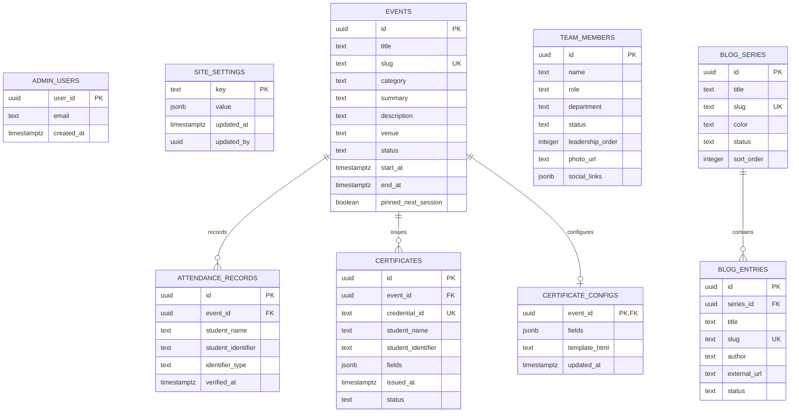
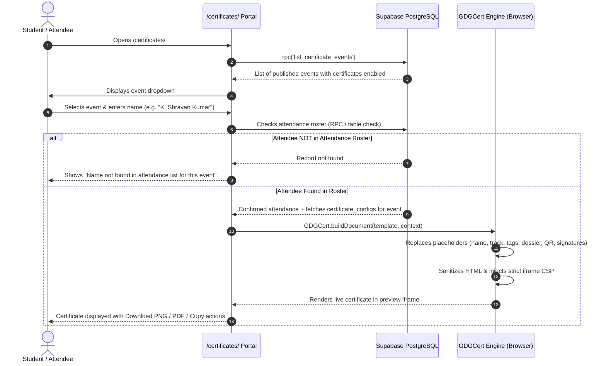

# System Architecture & Technical Specification

**Target:** GDG on Campus SR University Web Platform  
**Architecture:** Serverless JAMstack + Supabase BaaS + Client-Side Generation Engine

---

## 1. High-Level Architecture Diagram

---

## 2. Database Schema & Entity Relationships

---

## 3. Security Definers & Access Control

1. **`private.is_admin()` / `public.is_admin()`:**
   - Security Definer function checking if `auth.uid()` matches an ID in `public.admin_users`.
   - Execution privilege granted **strictly to authenticated users**.
   - **Never used in policies that apply to `anon`**.
2. **Row Level Security (RLS):**
   - Enabled on every table.
   - Public read policies are constrained to `status = 'published'` or `visible = true`.
   - Write operations (`INSERT`, `UPDATE`, `DELETE`) require `private.is_admin() = true`.
3. **Public Views (Security Invoker):**
   - `public_site_settings`: Exposes only whitelisted public keys (`social_links`, `contact_email`, `homepage_copy`, `brand_logo_url`, `team_page`).
   - `public_team_list`: Exposes only published team members with safe fields.
   - `public_event_list`: Exposes only published events.
   - `public_blog_list`: Exposes only published blogs.
   - `public_certificate_verification`: Exposes only `credential_id`, `event_title`, `recipient_name`, `issued_at`, and `status`.

---

## 4. Certificate Generation Lifecycle

